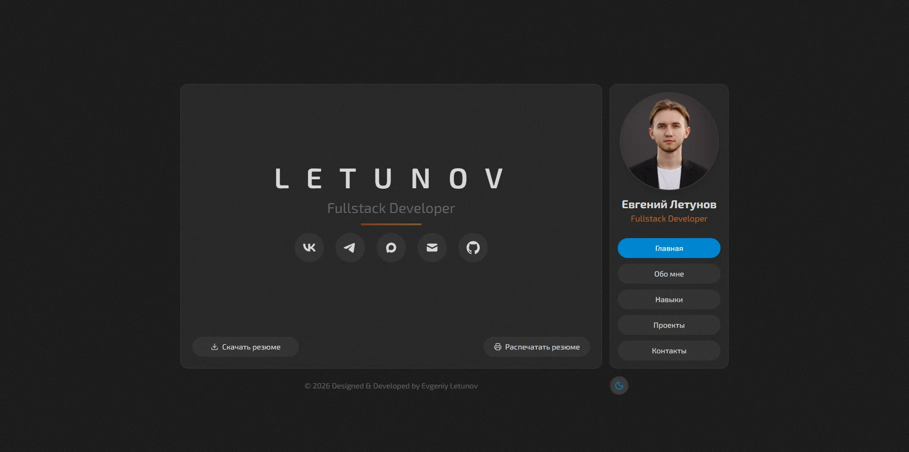
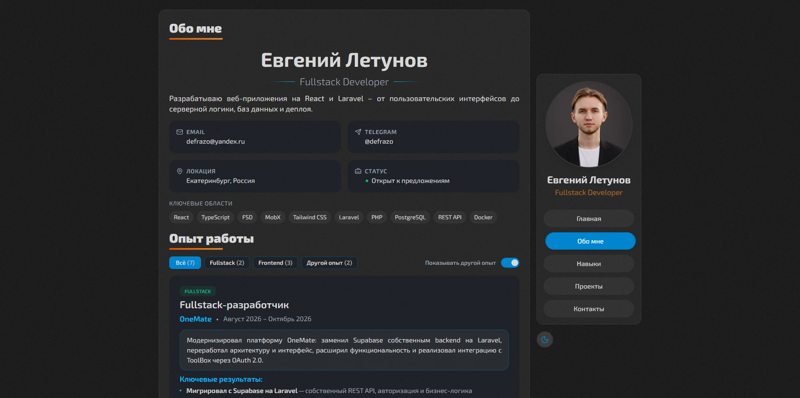
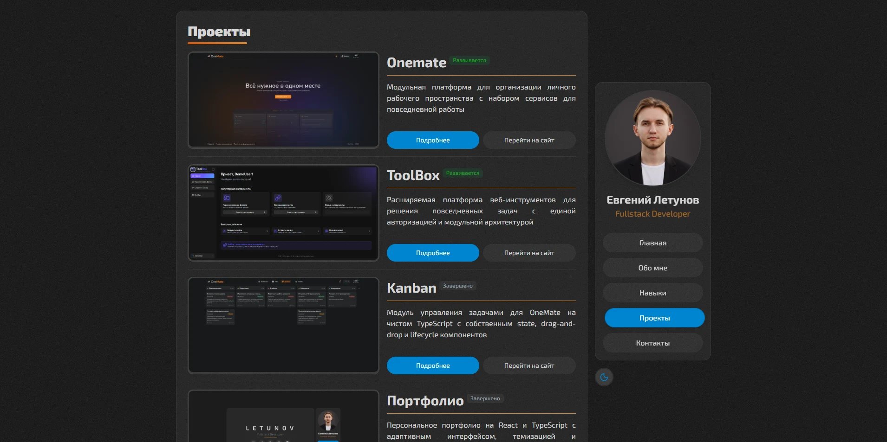
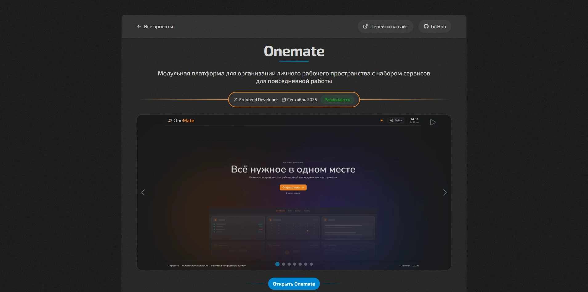

# LETUNOV – портфолио Fullstack-разработчика

**LETUNOV** – персональный сайт-портфолио с адаптивным интерфейсом, интерактивными разделами и подробным представлением проектов, технологий и профессионального опыта.

  

  

## Разделы

### Главная

**Стартовая страница** с краткой информацией о разработчике, основными технологиями и быстрым доступом к другим разделам портфолио.

### Обо мне

**Информация о разработчике** с описанием профессионального пути, образования и опыта работы над проектами.

### Навыки

**Каталог технологий** с группировкой по направлениям разработки и визуальным отображением уровня владения инструментами.

### Проекты

**Галерея разработанных приложений** с краткими описаниями, используемыми технологиями и переходом к подробной информации.

Каждый проект представлен на отдельной странице, включающей:

- описание проекта и решаемых задач;
- особенности реализации и принятые решения;
- используемые технологии;
- галереи скриншотов для desktop и mobile;
- дополнительные технические детали.

### Контакты

**Способы связи** и ссылки на профессиональные профили для быстрого перехода к общению.

## Технологический стек

### Frontend

- **React** и **TypeScript** – компонентная архитектура и строгая типизация;
- **FSD (Feature-Sliced Design)** – чёткое разделение ответственности и масштабируемая структура;
- **Tailwind CSS** – единый визуальный стиль и адаптивная вёрстка;
- **MobX** – реактивное управление состоянием приложения;
- **React Router** – маршрутизация между страницами и проектами;
- **Vite** – быстрый запуск и оптимизированная сборка.

### DevOps & Infrastructure

- **Docker** и **Docker Compose** – контейнеризация приложения и управление окружением;
- **Nginx** – reverse proxy и раздача статических ресурсов;
- **VPS** – развёртывание и администрирование проекта.

## Возможности

- **Адаптивный интерфейс** – отображение на мобильных устройствах, планшетах и десктопах;
- **Навигация** – переключение между информационными разделами и отдельными страницами проектов;
- **Темы оформления** – поддержка светлой и тёмной темы;
- **Интерактивность** – адаптация элементов управления под мышь и сенсорные устройства;
- **Галереи проектов** – просмотр скриншотов приложений с учётом формата устройства.

## Скриншоты

  
Показать

   

      
       
      
       
      
  

## Автор

